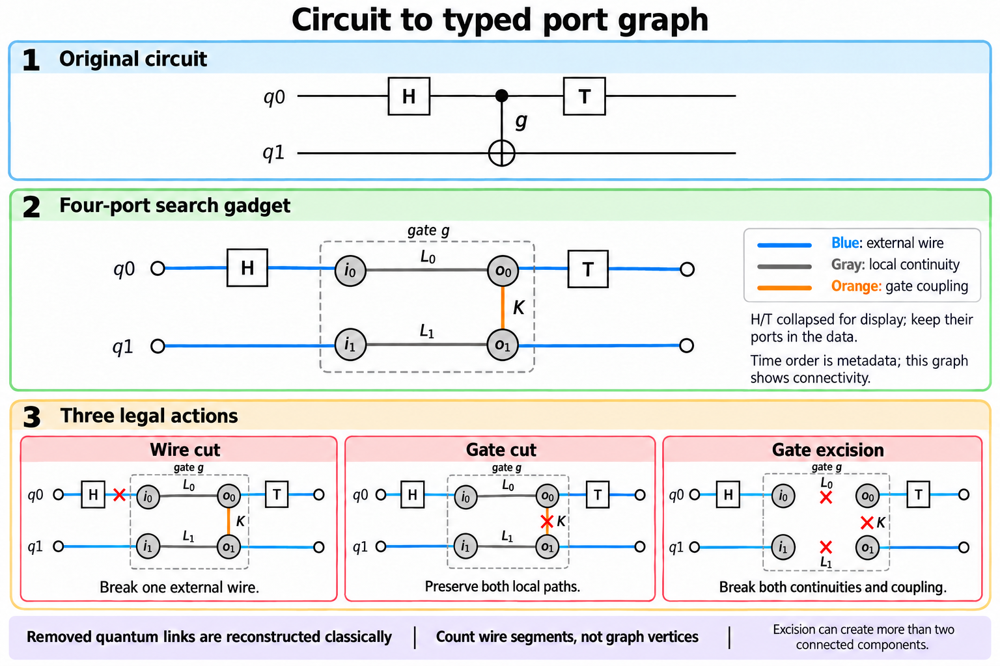

# Graph Representation Review: Wire Cuts, Gate Cuts, and Excision

Review date: 2026-10-14. This review follows the user's updated
[plan.md](plan.md): one-/two-qubit gates, fixed validated templates, independent
local decompositions, no runtime inter-fragment communication, static allocation,
and a coefficient-norm objective. Gate grouping and application-specific
objectives are excluded. The user's plan and production source files are unchanged.

## 1. Conclusion

**The graph described in the updated plan is suitable for the three operations.
The graph currently implemented in `temporal_graph()` is a semantic record,
not yet the required mixed-action search graph.**

Keep the semantic DAG and derive a typed undirected search graph from it. The
plan's dummy-node gadget is valid. An equivalent four-port gadget can remove
two dummy vertices per two-qubit gate, simplifying action updates and binary
label constraints. This is a representation refinement, not a new cutting
protocol or a claim of research novelty.

The unresolved modeling issue is the meaning of **2-way partition**. Exactly
two connected components and two executable blocks are different constraints,
especially after excision. Static width also places a strong restriction on
which cuts can fit in two blocks.

## 2. Current implementation versus the plan

| Representation | Useful information | Limitation for this search |
| --- | --- | --- |
| `interaction_graph()` | Original qubits and interaction counts; initialization seeds | Loses time and local gates. Cannot distinguish wire cut from gate excision. Counts are not lookup-table costs. |
| `temporal_graph()` | Inputs/outputs, operation IDs, gate ports, and ordered wires | A two-qubit operation is one shared center joined to all four ports. It lacks explicit per-operand continuation links and a separately removable coupling edge. |
| Updated plan's gadget | Two operand centers, local structural paths, interaction edge, excision scope | Suitable, provided annotations never become connectivity edges and width is computed from segments. |
| Proposed four-port search gadget | Explicit local continuations and one coupling witness | Equivalent topology for the declared action grammar, with fewer vertices/edges; direction remains in the semantic DAG. |

The current implementation is in
[circuits.py](src/qpartition/circuits.py). Removing the shared operation center
of its two-qubit gate breaks both local paths: that resembles the planned
excision footprint, not a standard gate cut. Removing just one incidence edge
also does not implement the required gate-cut transformation. This is a missing
derived representation, not a defect in the semantic DAG itself.

The existing standard cutter validates materialized widths, but automatically
extracts connected fragments. It does not implement a requested A/B block
assignment. Excision currently executes measurement/reset/preparation on the
original circuit registers. That verifies its channel reconstruction, but does
not implement the plan's separate static allocation of excision input/output
segments or a unified mixed partition compiler.

Mixed gate/wire port graphs have direct prior precedent in
[Optimal Partitioning](https://arxiv.org/abs/2308.09567) and the supplied
[gate-group framework, Section V-B](https://arxiv.org/html/2608.05287v1).
The additional excision grammar and its physical validation are the relevant
engineering extensions here.

## 3. Proposed typed four-port gadget

For a two-qubit gate $g$, retain four vertices:

$$
V_g=\{i_0,o_0,i_1,o_1\}.
$$

Create local-continuation edges and one interaction edge:

$$
L_0=(i_0,o_0),\qquad L_1=(i_1,o_1),\qquad K_g=(o_0,o_1).
$$

The particular output-port placement of $K_g$ is a connectivity convention;
it is not a physical interaction after the gate. The operation record still
identifies all four ports, the matrix/template, and ordered operands. The search
graph is undirected. Compilation uses the original ordered gate records and
wire metadata, not a directed interpretation of this bridge.

External wire edges link consecutive gates' ports. Input/output terminal edges
are retained; only the locations allowed by the plan become cut candidates.
Single-qubit gates have two ports and one local-continuation edge. H/T are
collapsed only in the illustration; their ports remain in the actual model.

| Gate mode/action | Deleted edges | Consequence |
| --- | --- | --- |
| Retain | None | All four ports belong to one local circuit component. |
| Gate cut | $K_g$ | Both per-operand paths remain; the two operands may occupy different blocks. |
| Gate excision | $L_0,L_1,K_g$ | Input/output allocation paths are interrupted on both operands. |
| Wire cut | One candidate external wire edge | Interrupt one path between operations. |

Charge excision **once**, using its lookup-table cost, rather than charging its
three removed edges separately. Store its four-port scope as an action record;
it must not reconnect those ports during component extraction. Classical
decomposition indices connect reconstruction factors, not quantum connectivity.

The graph records local circuit allocation and required template connectivity.
A retained local continuation does not assert a unitary channel: gate-cut
templates can include local measurements/resets while retaining the designated
local register path. Only validated templates with this connectivity contract
can use this gadget.

### Why compaction is valid

In the plan's dummy-node gadget, contract the structural link from each operand
center to its output port. This edge survives in retain/gate-cut modes; excision
has an explicitly defined deletion of the resulting local edges and bridge.
For all three modes, connectivity among the original boundary ports and the
count of allocation segments are unchanged. Thus each two-qubit gadget goes
from six vertices/five internal edges to four vertices/three internal edges.

This is not permission to contract input/output ports together: doing that
would erase excision's temporal break. Preserve all cut locations and single-qubit
excision scopes.

## 4. Binary formulation for two executable blocks

For this review, the recommended interpretation is two static executable blocks
A/B. Each may contain disconnected pieces, but combining them into one executable
circuit requires the sum of their allocated wire segments. Merely assigning many
fragments to two devices with sequential reuse is a different model.

Let $b_v\in\{0,1\}$ label ports, $z_w$ select wire cuts, $c_g$ select gate cuts,
and $e_g$ select excision. For one selected template per mode, impose

$$
c_g+e_g\leq1.
$$

For external wire $w=(u,v)$,

$$
|b_u-b_v|\leq z_w.
$$

For a two-qubit gate,

$$
|b_{i_0}-b_{o_0}|\leq e_g,\qquad
|b_{i_1}-b_{o_1}|\leq e_g,
$$

$$
|b_{o_0}-b_{o_1}|\leq c_g+e_g.
$$

A single-qubit gate has only the continuation constraint. These conditions
ensure that all surviving edges stay within one block. Multiple templates
replace each mode bit by compatible selection variables and their lookup costs.
They are necessary connectivity constraints, not complete width constraints.

The objective remains the user's additive template cost:

$$
\min\left[
\sum_w z_w\log\Omega_w
+\sum_g c_g\log\Omega_g^{\mathrm{gate}}
+\sum_g e_g\log\Omega_g^{\mathrm{exc}}
\right].
$$

Graph constraints do not need a physical matrix at each search step; the
template registry supplies validated costs and connectivity contracts. An
ordinary weighted edge cut cannot charge a bundled excision correctly without
extra variables or a valid reduction.

## 5. Static width and the meaning of 2-way

After transformations, compute allocation segments using **only surviving
external wire and local-continuation edges**. Ignore gate coupling edges for
this step. Each resulting segment costs one qubit and has a consistent block
label. Sum segments per block and enforce both sums at most $M$.

Compute local circuit components separately using all surviving connectivity
edges. Later interactions can rejoin different segments of one original qubit
into the same component; they still occupy separate qubits under static allocation.

For the plan's no-ancilla baseline, with all terminal and boundary-only segments
retained and no analytical elimination,

$$
N_{\mathrm{segments}}
=n+N_{\mathrm{wire\ cuts}}+\sum_{g\ \mathrm{excised}}\operatorname{arity}(g).
$$

Each selected break splits one original allocation path; gate cutting does not
split the designated local paths. Therefore a necessary condition for two
static blocks of width at most $M$ is

$$
n+N_{\mathrm{wire\ cuts}}
+\sum_{g\ \mathrm{excised}}\operatorname{arity}(g)\leq2M.
$$

This is a useful feasibility bound, not a sufficient partition certificate.
In particular, if $n=2M$, the model has no room for wire cuts or excision.
Use instances with width slack when testing all three techniques. If $n>2M$,
one two-block split cannot solve the baseline instance; recursive partitioning,
more fragments, or another allocation model is needed.

For a standalone CX, the topology is:

| Mode | Canonical connected components | Static widths |
| --- | ---: | --- |
| Retain | 1 | 2 |
| Gate cut | 2 | 1, 1 |
| Excision | 4 | 1, 1, 1, 1 |

The excision result can be packed into two disconnected executable blocks of
width two, but it is not exactly two connected components. If exactly two
connected components are intended, add that explicit global constraint and
accept that some excision patterns are excluded.

## 6. Verification performed and limits

The review-only checker in
[check_topology.py](validation/graph_representation_review/check_topology.py)
enumerated every allowed retain/gate-cut/excision mode and external-wire-cut
combination on four small circuits. It compares the dummy-node and compact
representations' component membership and segment widths.

| Circuit | Action combinations |
| --- | ---: |
| H–CX–T–CX on two qubits | 576 |
| H–CX–CX chain on three qubits | 72 |
| H–T on one qubit | 8 |
| CX plus an idle third wire | 3 |
| Total | **659** |

All comparisons and the global segment-count identity passed. The checker also
ran the existing standard cutting compiler on H–CX–T–CX with a wire cut before
T. The original circuit has two qubits, but the resulting single connected
fragment uses three allocated qubits. Its exact reconstructed expectation matched
the uncut reference, with zero error for that query.

Results are saved in [report.json](validation/graph_representation_review/report.json).
These checks verify the declared topology/resource model on the tested cases.
They do not constitute a new mixed-excision compiler, arbitrary-channel template
validation, hardware execution, or an optimizer optimality proof.

## 7. Recommended algorithm and next implementation contract

1. Derive the typed search graph from the semantic DAG and register each action's
   edge-deletion footprint, template ID, cost, and operand roles.
2. Implement a graph evaluator that separately reports components, segments,
   block widths, conflicts, and total lookup cost.
3. Establish tiny-instance exact enumeration or a binary MILP/SMT baseline.
4. Apply legal label moves and action switches with exact cost/width reevaluation.
   A label-only KL move can miss the coordinated action changes needed at a gate.
5. Add small neighborhood reoptimization after the single-move baseline works.
   Use min-cut only for justified additive subproblems; the full excision bundle
   and global width constraints require more than ordinary min-cut.
6. Compile and verify mixed plans under the same static allocation contract
   before claiming executable improvements.

Keep disconnected-block merging explicit. Avoid pruning adjacent cuts merely
because a drawing appears redundant; first prove that restoring them preserves
the selected model's width and reconstruction contract.

Excision usefulness also deserves an early dominance study. For the user's
fixed Pauli-eigenstate template, $\Gamma_{\mathrm{exc}}=\sum_{P,Q}|R_{QP}|$.
An orthogonal $d^2$-dimensional PTM has each row's $\ell_1$ norm at least one,
so $\Gamma_{\mathrm{exc}}\geq d^2$: at least 4 for one qubit and 16 for two.
This can be expensive against wire/gate alternatives. It is not, by itself, a
proof that excision is always dominated: candidate locations, block feasibility,
and available templates must also be compared.

## 8. Illustration provenance

The figure was produced with the **imagegen skill's built-in image tool**, then
edited with that tool to remove an incorrectly generated extra connection.
The final topology was visually inspected. It illustrates the gate gadget;
the executable source of truth remains the graph specification and compiler.

- Final project asset: [circuit_typed_port_graph.png](docs/images/circuit_typed_port_graph.png).
- Generation prompt: [port_graph_prompt.txt](docs/images/port_graph_prompt.txt).
- Correction prompt: [port_graph_edit_prompt.txt](docs/images/port_graph_edit_prompt.txt).
