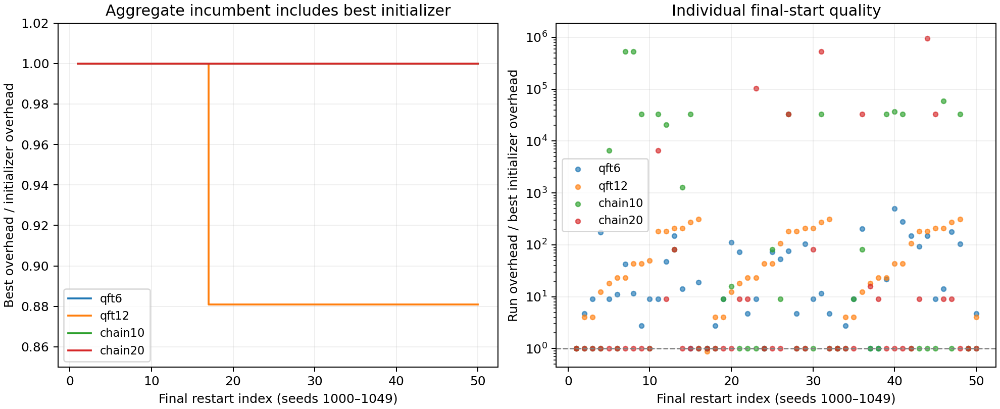
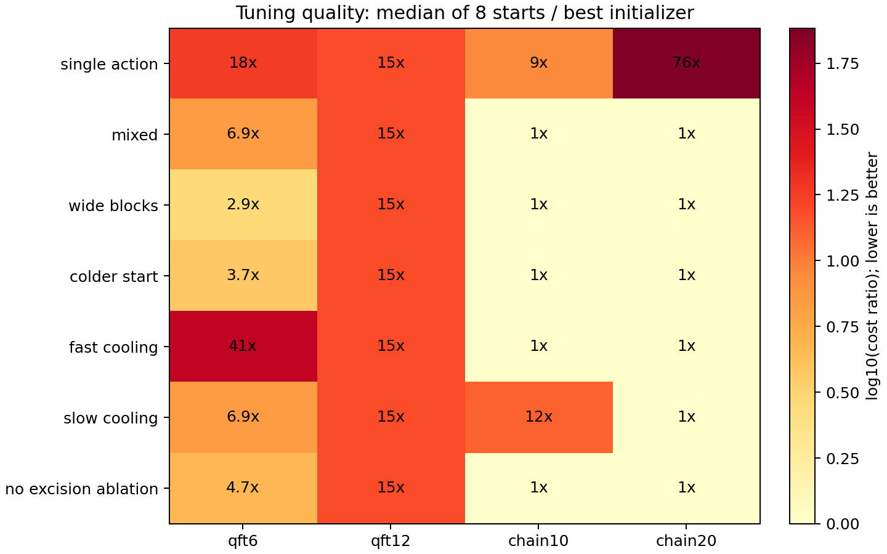

# First hybrid simulated-annealing experiment

The implementation finds a feasible QFT12 partition with overhead
**701,729.0531647**, 11.92% below the reproduced spatial gate-cut baseline
796,655.9190897. This is the first evidence that temporal wire cuts can improve
our graph-based search beyond spatial seeds. It is a result on a reconstructed
circuit, not a verified improvement on the authors' original artifacts.

The user-authored `plan.md` was preserved. The implementation follows the
[SA design](SA_METHOD_DESIGN.md): typed port connectivity, categorical gate actions,
a physical signed-template LUT, static segment counting, and feasibility-first
incumbents. Wire cutting, gate cutting, and gate excision compile through one
lazy reconstruction path. No gate grouping or qubit reuse is included.

## Comparison with Table I

The paper uses width `floor(3*n/4)`, bipartitioning, and best-of-50 results.
All four selected plans actually have two connected components, so their reported
widths do not depend on packing several components into a common block.

| Circuit | Limit | Paper without groups | Paper with groups | Our best of 50 | Widths | Interpretation |
|---|---:|---:|---:|---:|---|---|
| QFT6 | 4 | 2.5e3 | 42 | 2,521.7503 | 2, 4 | Matches rounded ungrouped baseline |
| QFT12 | 9 | 8.0e5 | Not reported | 701,729.0532 | 5, 8 | Below rounded ungrouped baseline |
| Chain10 | 7 | 16 | 16 | 16 | 4, 7 | Matches on structural proxy |
| Chain20 | 15 | 16 | 16 | 16 | 8, 13 | Matches on structural proxy |

See [provenance](benchmarks/README.md) for reconstruction limits and the four
remaining Table-I rows. In particular, our QFT6 result is substantially above the
paper's grouped overhead 42. This experiment establishes no superiority over
grouped cutting.

The winning QFT12 run uses seed **1016**, the `colder_start` configuration,
**30 gate cuts + one wire cut**, and no excisions. The wire cut is on original
qubit 9 immediately before operation `op000023`. It increases total allocated
segments from 12 to 13, while both fragments fit the nine-qubit limit. The
trace improves after approximately 4,500 SA steps and reaches the final cost by
step 5,100, before coordinate polishing. The saved
[plan](validation/sa_benchmarks/qft12/best_plan.json) and
[source circuit](validation/sa_benchmarks/qft12/source.qasm) specify the result.

QFT6 and both chains already have their final best values in the initialization
pool. Matching these baselines is not credited as an SA discovery. The chain
gate-only spatial cost is 531,441; a single temporal wire cut reduces it to 16.

## Experimental protocol and stability

Experiments ran in conda environment `quantum-partition`, with Qiskit 2.5.2,
qiskit-addon-cutting 0.10.0, Aer 0.17.2, NumPy 2.5.3, and NetworkX 3.7.
The report records package versions, source-PDF SHA256, circuit fingerprints,
complete configuration values, seeds, evaluation counts, and timing.

- Each profile uses 6,000 SA steps, 64 temperature probes, 120 temperature levels,
  and deterministic coordinate polishing. The baseline cooling rate is 0.93,
  initial uphill acceptance 0.8, and local-block probability 0.3/size 4.
- Seven profiles use eight tuning starts each: single-action moves, baseline
  mixed moves, wider blocks (probability 0.6/size 8), colder start (acceptance 0.55),
  faster cooling (0.85), slower cooling (0.97), and no-excision ablation.
- Select an instance-specific full-action profile by tuning best cost, then median
  cost. The no-excision ablation is reported but excluded from final selection.
  Fifty fresh seeds 1000–1049 evaluate the selected profile on the same circuit.
  This tests restart behavior, not generalization to unseen circuit families.
- Initializers are shared across profiles. For at most 14 qubits, initialization
  scores spatial bipartitions; it also checks individual wire cuts. The pool is
  diverse, and starts cycle through it. A run preserves its own initial incumbent,
  rather than receiving the pool's global best automatically.
- Ten additional component-mode starts on each QFT test the multiway extension.
  These relax the two-block restriction and are excluded from the Table-I comparison.

This totals **444 trajectories**: 224 tuning, 200 final, and 20 multiway. The main
sweep took approximately 110 seconds with four workers on this workstation.
Initialization time is recorded separately; per-run evaluation counts include
pilot probes and polishing. Extra tuning and seed construction mean this is not
a budget-matched runtime comparison with the paper's 50 runs.

| Circuit | Selected profile | Final median | Final 90th percentile | Runs matching/improving best initializer | Runs reaching suite best |
|---|---|---:|---:|---:|---:|
| QFT6 | Wider blocks | 25,471.8 | 386,061.6 | 8/50 | 8/50 |
| QFT12 | Colder start | 34,595,725.2 | 219,046,820.5 | 4/50 | 1/50 |
| Chain10 | Colder start | 16 | 531,441 | 28/50 | 28/50 |
| Chain20 | Colder start | 16 | 531,441 | 33/50 | 33/50 |

All final runs found feasible plans. Feasibility is much more reliable than
solution quality. The QFT12 improvement appears in only one of 50 final starts;
high medians show that the current proposal is not yet a robust optimizer.
Multi-start protects the aggregate incumbent, but does not eliminate poor runs.



The plot's left panel includes the best initializer in the aggregate incumbent;
the right panel shows each run's own result. This distinction prevents a strong
initializer from hiding the poor quality of many trajectories.

The tuning medians show why changing the move mechanism matters:

| Profile | QFT6 | QFT12 | Chain10 | Chain20 |
|---|---:|---:|---:|---:|
| Single action | 45,298.3 | 12,261,000 | 144 | 1,224 |
| Mixed | 17,452.7 | 12,261,000 | 16 | 16 |
| Wider blocks | 7,245.5 | 12,261,000 | 16 | 16 |
| Colder start | 9,445.9 | 12,261,000 | 16 | 16 |
| Faster cooling | 104,129 | 12,261,000 | 16 | 16 |
| Slower cooling | 17,452.7 | 12,261,000 | 200 | 16 |
| No excision | 11,969.3 | 12,261,000 | 16 | 16 |

Tuning best costs all equal the corresponding best initializer. With only eight
tuning starts, profile selection is weak evidence; all QFT12 profiles tie and
`colder_start` wins the deterministic name tie-break. The better final result
does not establish that colder starts are intrinsically preferable.



Neither ten-start multiway QFT experiment improves the best two-block cost.
No best plan uses excision. Excision is implemented and verified, but its current
Pauli measure/prepare decomposition has expensive physical coefficients (a CX
excision has overhead 256, versus 9 for its standard gate cut). These instances
provide no evidence of an excision advantage; a better decomposition library or
an instance requiring its additional disconnections would need a separate study.

## Verification and limits

The full suite passes **86 tests**, including exact reconstruction of all three
actions together, Pauli sums, reversed CX operands, controlled-phase and SWAP
gates, entangled spectators, finite-shot resource accounting, template channel
identities, serialization, and exhaustive small-case references. A gate with a
spoofed standard name cannot silently select an incorrect QPD: the registry
validates the channel and falls back to matrix-based decomposition.

For every winning large plan, 16 sampled physical branches compile within the
width limit. Width allocation is independent of the chosen decomposition branch.
An independent Qiskit `cut_gates` / `cut_wires` / `partition_problem` path confirms
both component widths and physical QPD coefficient norms. The
[cross-checks](validation/sa_benchmarks/qiskit_crosschecks.json) agree to numerical
precision. Large circuits were not fully enumerated or run on hardware.

Bounded exhaustive search completes on both chain proxies and certifies overhead
16 under this template library and static two-block constraints. Both QFT searches
reach the 100,000-node limit, so their solutions have no optimality certificate.
The optimized cost is the squared physical coefficient norm under independent
composition. Observable-specific variance, depth, device errors, communication,
and grouped decompositions are outside this comparison.

Saved data are in [report.json](validation/sa_benchmarks/report.json). Each case
also contains initialization states, all tuning/final traces, the LUT, source
QPY/JSON/QASM, the best plan, sample physical branches, and the bounded-search
reference. Plots and a compact CSV are generated by:

```bash
# Matplotlib is optional: install the project's [plots] extra in the plotting environment.
python examples/plot_sa_results.py --directory validation/sa_benchmarks
```

The next algorithmic priority is coordinated boundary moves that replace several
gate cuts with a wire cut while preserving feasibility. That directly targets
the improvement found on QFT12 and the poor quality of most independent runs.
Further experiments should use held-out seeds and circuits, matched evaluation
budgets, and the best initializer as an explicit baseline.
