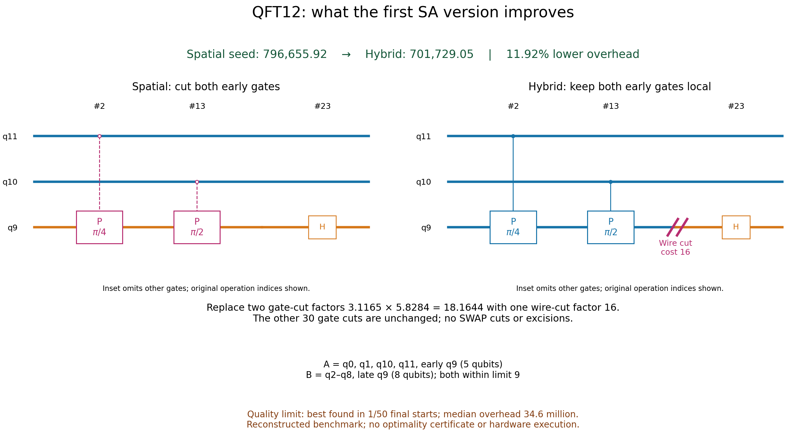

# Implemented hybrid circuit partitioning algorithm

This document describes the executable first version, rather than the earlier
[design proposal](../SA_METHOD_DESIGN.md). The scientific objective is minimum
sampling overhead under a static qubit-capacity constraint. The search combines
wire cuts, two-qubit gate cuts, and whole-gate excisions in one categorical action
space. Its output includes physical local circuits and a classical reconstruction
rule. The user's [plan](../plan.md) is unchanged.

## 1. Inputs, outputs, and scope

The input is a `CircuitProblem`: an ordered quantum circuit and a Hermitian
Pauli-sum observable. Input states are products; preparation gates belong in the
circuit, whose default initial state is the all-zero state. All parameters are
bound. The hybrid graph accepts only one-/two-qubit unitary gates and barriers.
Input measurements, resets, classical registers, and control flow are excluded.
Wider gates must first be decomposed explicitly. That normalization changes the
optimization instance and must be recorded in benchmark provenance.

Additional inputs are the maximum executable width $M$, partition policy,
enabled cutting actions, and SA parameters. The primary policy permits at most
two static executable blocks. A second policy executes every connected component
separately, allowing multiway partitions.

Outputs are a feasible `GraphEvaluation`, a snapshot-bound `HybridPlan`, and a
`CompiledHybrid`. The evaluation records overhead, graph-component widths,
executable-block widths, segment allocation, action counts, and packing witness.
The compiler can generate one signed experiment branch at a time. Exact or
sampled reconstruction is optional and separate from optimization.

There is no qubit reuse, communication between devices, grouped decomposition,
depth constraint, device-noise optimization, or observable-dependent cost in the
baseline. Connected components may be combined into one executable block only
by adding their disjoint registers; this does not reduce their combined width.

## 2. Typed port graph

For a one-qubit gate $g$, create input and output ports and a continuation edge
$L_g$. For a two-qubit gate, create four ports:

$$
V_g=\{p_{g,0}^{\mathrm{in}},p_{g,0}^{\mathrm{out}},p_{g,1}^{\mathrm{in}},p_{g,1}^{\mathrm{out}}\}.
$$

Create two continuation edges $L_{g,0},L_{g,1}$ and one coupling edge $K_g$.
The code places $K_g$ between the output ports. With both continuation edges
present, this enforces the gate's complete connectivity. It is a connectivity
gadget, not a representation of physical information flowing between outputs.

Consecutive operations on an original qubit are joined by a temporal wire edge.
Every original qubit also has explicit input/output boundary nodes, including
idle wires. Boundary connections are fixed. Barriers contribute no action
variables. A temporal cut is available between consecutive non-barrier gates,
not before the first or after the final operation on a wire.

Stable operation IDs refer to the original ordered snapshot, before inserting
any cut instructions. Port metadata retains the ordered gate operands. Graph
connectivity is undirected for partition evaluation; the original operation
order supplies execution causality. Arbitrary graph traversal order is never
used to compile the circuit.

### Legal action alphabets

Each candidate temporal wire has two options: retain or wire cut. Each
one-qubit gate has retain or excision. Each two-qubit gate has retain, gate cut
when a validated QPD is available, or excision. Index zero always means retain.
Each option references a template in the registry.

| Action | Temporal wire | Continuation edges | Coupling edge | Cost charged |
|---|---|---|---|---|
| Retain gate/wire | Present | Present | Present for two-qubit gate | Zero |
| Wire cut | Removed at that boundary | Unchanged | Unchanged | One wire template |
| Two-qubit gate cut | Unchanged | Both present | Removed | One gate template |
| Whole-gate excision | Unchanged | All removed | Removed | One excision template |

Excision is one categorical decision with an entire edge footprint. Independently
toggling its internal edges would permit unsupported partial excisions and
miscount the cost. Nearby wire cuts and excisions may coexist; no unproven
dominance rule removes them.

The state is a tuple of option indices:

$$
s=(s_1,\ldots,s_d),\qquad s_v\in\mathcal A_v.
$$

It contains actions, not an independent partition label for each port. Applying
the actions determines components and their assignment to executable blocks.

## 3. Physical decomposition LUT

For each supported action $a$, store a signed channel decomposition, local
instructions, coefficient list, footprint/arity, and numerical channel residual.
With bounded local measurement scores, define

$$
\Gamma_a=\sum_j|c_{a,j}|.
$$

$$
\Omega_a=\Gamma_a^2,\qquad \ell_a=2\ln\Gamma_a.
$$

The first version uses Qiskit's `QPDBasis` for gate cuts and the Peng `Move`
decomposition for wire cuts. Local operations include unitary gates, resets,
and scored measurements. A `qpd_measure` is a physical computational-basis
measurement whose outcome contributes a parity sign; it is not an ordinary
unscored dephasing channel in the reconstruction identity.

| Template | Physical norm | Overhead |
|---|---:|---:|
| Wire cut | 4 | 16 |
| CX gate cut | 3 | 9 |
| SWAP gate cut | 7 | 49 |
| CX excision, current eigenstate expansion | 16 | 256 |

For the installed controlled-phase basis, the following formula agrees with
the validated coefficients:

$$
\Gamma_{\mathrm{CP}(\theta)}=1+2|\sin(\theta/2)|.
$$

The implementation obtains costs from the actual coefficient list, rather than
assuming a gate-name formula. Templates are cached using SHA256 of the gate name
and its ordered complex unitary matrix. Thus gates with different bound angles
have different cache entries. The registry is scoped to the running implementation
and dependency versions; this hash is not a universal cross-version template ID
or a certificate of optimality.

Every new gate QPD is checked on all 16 two-qubit product Paulis against the
actual target channel. The wire transfer identity is checked on all four
one-qubit Paulis. If name-based dispatch returns the wrong channel for a custom
gate, the code tries matrix-based `UnitaryGate` decomposition. Residuals above
$10^{-10}$ reject the template. Stored residuals, local matrices, coefficients,
and resource-model labels make the LUT auditable.

## 4. Gate excision mathematics

For a $k$-qubit unitary $U$, let $P,Q$ range over its $4^k$ Pauli products. Define
the Pauli transfer matrix

$$
R_{Q,P}=\frac{\operatorname{Tr}(QUPU^\dagger)}{2^k}.
$$

For any input operator $X$, including operators correlated with untouched
qubits through linear extension, the channel has the identity

$$
UXU^\dagger=\frac{1}{2^k}\sum_{P,Q}R_{Q,P}\operatorname{Tr}(PX)Q.
$$

This is an algebraic measure/prepare expansion. To execute it physically, expand
each output Pauli into product eigenstate projectors:

$$
Q=\sum_{b\in\{0,1\}^k}\sigma(Q,b)\rho_{Q,b}.
$$

For nonidentity factors, eigenbit one contributes a minus sign. For an identity
factor, both computational-basis projectors have positive sign. Each branch
measures the nonidentity input Pauli factors, multiplies their outcome signs,
and prepares the specified output product eigenstate on fresh segments. Its
coefficient is

$$
c_{P,Q,b}=\frac{R_{Q,P}\sigma(Q,b)}{2^k}.
$$

The physical norm of this particular unmerged expansion therefore satisfies

$$
\Gamma_{\mathrm{exc}}=\sum_{P,Q}|R_{Q,P}|.
$$

For a Clifford gate, the transfer matrix is a signed permutation of size $4^k$,
so this construction has norm $4^k$. A CX excision consequently has overhead
256. This explains its disadvantage relative to a standard CX gate cut of
overhead nine; it does not establish a universal lower bound for excision.

The hybrid registry calls `decompose_excision` with tolerance zero: all nonzero
floating-point coefficients are retained. It verifies the resulting channel on
the complete Pauli basis. Numerical precision is still finite. The separate
manual excision adapter has a configurable truncation tolerance and reports
discarded PTM norm; that approximation is not used by this optimizer.

## 5. Sampling objective

Independent composition of selected templates gives the product bound

$$
\Gamma(s)=\prod_{a\in A(s)}\Gamma_a.
$$

$$
\Omega(s)=\Gamma(s)^2.
$$

SA evaluates the logarithm, avoiding exponential scaling inside its energy:

$$
C(s)=\ln\Omega(s)=\sum_{a\in A(s)}\ell_a.
$$

This is an exact evaluation of the chosen independent-template norm bound,
within floating-point precision. It is not the minimum over all decompositions
and is not the actual variance of a particular observable. Costs multiply even
when the affected ports later rejoin the same component: an action cannot be
made free merely because it fails to disconnect the circuit.

Observable coefficient norm is excluded from the optimizer because the same
query is fixed across candidate partitions. It is included in the sampled
estimator's norm, described below.

## 6. Connectivity versus allocated width

Each state is evaluated with two disjoint-set passes:

1. Keep all enabled edge types to find connected circuit components.
2. Keep only enabled continuation and wire/boundary edges to find allocation
   segments. Coupling edges connect qubits but never identify their registers.

Each allocation segment occupies one static qubit. Count segments within each
connected component to obtain widths $w_1,\ldots,w_{K_c}$. A qubit may split and
later rejoin a component; its different segments still require different static
registers. Counting original qubit IDs would understate that width.

The evaluator checks the conservation identity

$$
W(s)=\sum_{i=1}^{K_c}w_i=n+N_{\mathrm{wire}}+\sum_{g\ \mathrm{excised}}\operatorname{arity}(g).
$$

Gate cuts add no allocation segments. Wire cuts add one; a two-qubit excision
adds two. Input/output-only and idle segments are retained. No implicit boundary
elimination, reset-based reuse, or ancilla discount changes this accounting.

## 7. Partition policies and exact packing

### Components mode

Every connected component executes separately. Width feasibility requires

$$
\max_i w_i\le M.
$$

The number of executable blocks is $B=K_c$. Its violation penalty is

$$
P_Q(s)=\sum_i[\max(0,w_i-M)]^2.
$$

### Two-block mode

Connected components are indivisible items. Let $\mathcal R$ be their reachable
subset sums. A choice $r$ gives block widths $r$ and $W-r$. Feasibility requires

$$
\mathcal R\cap[W-M,M]\ne\varnothing.
$$

The code computes reachable sums with an integer bitset. It stores predecessor
witnesses for newly reachable sums, enabling exact reconstruction of the packing.
Among sums it minimizes squared overflow, then imbalance, then subset sum:

$$
P_Q^{(2)}(s)=\min_{r\in\mathcal R}\left([\max(0,r-M)]^2+[\max(0,W-r-M)]^2\right).
$$

An empty block is omitted, so this means **at most two blocks**, not exactly two
connected components. The optional `max_components` parameter is an upper bound,
not an equality constraint. Exact component-count constraints from the earlier
proposal are not implemented.

The condition $W\le2M$ is necessary but not sufficient: components of widths
$(2,2,2)$ cannot fit into two blocks of capacity three. Conversely, several small
components can share a block by using disjoint static registers. If $n>2M$, the
original inputs alone prove infeasibility and SA rejects the two-block instance.
If $n=2M$, any wire cut or excision would exceed total capacity.

## 8. Energy, penalties, and fragment count

The optimization problem is

$$
\min_{s\in\prod_v\mathcal A_v}C(s)\quad\text{subject to declared width/count constraints}.
$$

Search may temporarily visit infeasible states. Its energy is

$$
E(s)=J(s)+\lambda P(s).
$$

For the baseline, $J=C$. The penalty $P$ is the selected width-policy penalty
plus an optional component-cap violation:

$$
P(s)=P_Q(s)+[\max(0,K_c-K_{\max})]^2.
$$

The cap term is omitted when unset. In two-block mode, substitute the exact
packing penalty for $P_Q$. All constraints are checked again when creating the
returned plan; low penalized energy never substitutes for feasibility.

Compute an upper bound using only enabled options:

$$
C_U=\sum_v\max_{a\in\mathcal A_v}\ell_a.
$$

The implemented scale is the maximum of one and the median log cost of all
enabled non-retain options, including any zero-cost options. With no such
options, the scale is one. The default coefficient is

$$
\lambda=C_U+c_{\mathrm{scale}}.
$$

Since violations are integer-valued, every infeasible state has penalty at least
one. With nonnegative validated template costs, this default makes any infeasible
energy exceed any feasible baseline objective. That separates global minima;
it does not guarantee a finite SA trajectory reaches one. `penalty_multiplier`
rescales the coefficient; values below one waive this dominance guarantee.

There is no arbitrary fragment-count soft penalty. An optional execution-bound
objective, `fragment_shots`, uses

$$
J(s)=C(s)+\ln B(s).
$$

It models $B$ independently executed fragment shots per reconstruction trial,
giving a physical-shot bound proportional to $B\Omega$. It does not model circuit
latency or optimal variance allocation. In this mode the penalty upper bound
also includes $\ln|V|$, which bounds $\ln B$.

## 9. Initial states

`seed_states` constructs up to 16 distinct ranked starting states. When all
two-qubit gates have enabled gate-cut templates, spatial seeds assign a color
to each original qubit and gate-cut interactions between colors. Original
qubits stay in the same group throughout the circuit.

For at most 14 qubits and $n\le2M$, the code scores all bipartitions with qubit
zero fixed to one color, discarding colorings above the capacity limit. Otherwise,
it generates randomized balanced spatial colorings. The number of colors is at
least two and large enough to distribute the original qubits at the requested
capacity. A two-block evaluator may still reject incompatible colorings.

Additional candidates include all supported two-qubit gate cuts, all retained
operations, all temporal wire cuts, and each individual wire cut. If gate cuts
are disabled/unavailable, the all-cut seed may use excision; feasibility is
checked, not assumed. Single-wire seeds are why the chain baseline of 16 is
already present before annealing.

Candidates are deduplicated and evaluated. Feasible candidates are preferred and
ranked by cost and state tuple. If none is feasible, infeasible candidates become
the starting pool. This initializer itself performs optimization work; its time
must be separated from per-trajectory evaluation counts.

## 10. Symmetric neighborhood proposals

Mutable variables have more than one enabled option. A single-action proposal
selects one uniformly and replaces its option uniformly by a different allowed
option. This proposal is symmetric because each variable has a fixed alphabet.

With `block_probability`, a multi-variable proposal is used instead:

- With probability 0.7, choose a static motif uniformly when motifs are available.
- Otherwise, grow a local region from a random mutable variable in the fixed
  action-adjacency graph, up to `block_size` variables.
- Independently redraw every selected variable uniformly from its full enabled
  alphabet, including its current option.

Motifs include a gate with neighboring temporal boundaries, neighboring wire
boundaries, and a wire boundary with its nearest two-qubit gates before/after.
Single-qubit gates remain in the circuit but need not inflate the last motif.
Only motifs fitting the configured block size are eligible.

Region selection depends on the immutable graph and enabled action alphabets,
not the current state. Uniform redraws therefore give symmetric forward/reverse
probabilities. Redraws may leave the state unchanged. No connectivity-dependent
repair or biased selection of existing cuts changes the proposal distribution.
These are generic coordinated redraws, not a deterministic gate-to-wire rewrite.

## 11. Calibration, acceptance, and cooling

First, probe `pilot_steps` proposals around the initial state without advancing
the chain. Positive penalized energy differences determine the initial
temperature. Feasible pilot candidates can improve the incumbent archive.
For target initial uphill acceptance $p_0$:

$$
T_0=\frac{\operatorname{median}(\Delta E>0)}{-\ln p_0}.
$$

If no positive differences are observed, use the cost scale as the numerator.
At each main step, accept a changed proposal $s'$ with probability

$$
\Pr(\mathrm{accept})=\min\left(1,\exp\left(-\frac{E(s')-E(s)}{T}\right)\right).
$$

For $N$ main steps and $L$ temperature levels, zero-based step $t$ uses

$$
T_t=\max\left(10^{-12},T_0r^{\min(L-1,\lfloor tL/N\rfloor)}\right).
$$

The cooling factor $r$ is applied per temperature level, not per proposal. The
reported final temperature is the last level actually reached. Exponent clipping
prevents numerical overflow/underflow. A fixed seed controls calibration,
proposal selection, and acceptance randomness.

Every evaluated feasible candidate can update the archive, including candidates
not accepted by the current chain. Archive rank is objective, then number of
executable blocks, then the state tuple. After SA, deterministic coordinate
descent attempts each enabled single-variable replacement from the archive until
that ranking no longer improves. It does not cross infeasible or uphill states.
It certifies no global optimum.

## 12. Multi-start, parallelism, and accounting

`multi_start` cycles trajectories through the shared initializer pool and assigns
an explicit random seed to each. Each run preserves its own starting incumbent;
it is not automatically initialized with the pool's global best. This distinction
explains why some final runs are much worse than the best initializer.

With `workers > 1`, a process pool runs independent trajectories; its returned
order matches the input seeds. A serial/two-worker smoke check confirmed identical
states, traces, and evaluation counts for the same seeds. Wall time can differ.
Use a main guard for portable process spawning.

The evaluator uses an LRU cache of complete action tuples. Reported evaluation
counts are cache misses, including pilot probes, main search, and polishing;
evicted states can be recomputed. Proposal counts include the pilot budget and
main steps, while accepted/changed/block counters refer to the main chain.
Elapsed time includes per-run preparation and polishing. Shared initialization
is measured separately in the benchmark runner. Approximately 20 trace checkpoints
record temperature, current feasibility/cost, and best feasible log cost.

The first implementation recomputes connectivity, segment allocation, packing,
and summed cost for each uncached state. It does not implement incremental dynamic
connectivity or local cost deltas. The evaluation requires two graph passes and
a subset-sum calculation. LUT caching avoids recomputing gate decompositions;
the capacity DP can become a bottleneck for large segment counts. Current results
are small-instance evidence, not a thousand-qubit scalability claim.

## 13. Physical compilation and classical reconstruction

`HybridPlan` stores the circuit fingerprint, full state, template IDs, capacity,
partition mode, and optional component cap. Loading checks schema versions;
compilation checks snapshot identity, selected templates, and feasibility.
Queries are stored in `CircuitProblem` rather than in the partition plan.

For each allocation segment, the compiler assigns one register in its packed
block. It then scans the original circuit order. Retained gates execute normally
on their block. Gate-cut branches insert the template's local operations. Wire
branches act separately on the old and new segments. Excision branches score
input Paulis and prepare fresh output segments. No branch-dependent register
allocation can reduce the reported width.

The final observable Pauli factors are measured on the output segments. Every
block's cut-measurement and observable signs combine into one joint parity score.
Keeping the joint bitstrings preserves correlations between multiple measurements
inside a block. Scores from distinct block executions are multiplied using
independent shots. A constant-score block receives a dummy unscored measurement
when required by Aer; that measurement does not alter the reconstruction score.

For a Pauli sum $O=\sum_m h_mP_m$ and a global template assignment $j$, define

$$
d_{j,m}=h_m\prod_a c_{a,j_a}.
$$

The exact reconstruction is

$$
\langle O\rangle=\sum_{j,m}d_{j,m}\prod_{b=1}^{B}\mathbb E[S_{b,j,m}].
$$

`run_exact` enumerates nonzero-coefficient assignments and observable terms with
an explicit experiment-count guard. Local exact execution handles measurements
and resets by branch probabilities. This is a small-circuit oracle, not the
benchmark optimizer's inner loop.

### Importance sampling

`run_sampled` independently samples each template index with probability
$|c_{a,j}|/\Gamma_a$ and observable index with probability $|h_m|/H$, where

$$
H=\sum_m|h_m|,\qquad \Gamma_{\mathrm{est}}=H\prod_a\Gamma_a.
$$

One reconstruction trial produces

$$
X=\Gamma_{\mathrm{est}}\operatorname{sign}(d_{j,m})\prod_b S_{b,j,m}.
$$

Under ideal local execution its expectation is the desired observable. Its
magnitude is constant, so

$$
\operatorname{Var}(X)=\Gamma_{\mathrm{est}}^2-\langle O\rangle^2\le\Gamma_{\mathrm{est}}^2.
$$

Repeated global assignments are batched. Each block's measured parity histogram
is independently shuffled before pairing its scores into trials, recovering
independent fragment trial products. The sample standard-error estimate is

$$
\widehat{\mathrm{SE}}=\sqrt{\frac{\Gamma_{\mathrm{est}}^2-\overline X^2}{N-1}}.
$$

This is sampling uncertainty, not a confidence guarantee or a device-bias bound.
There is no clipping of reconstructed expectation values. For $N$ trials and
$B$ static blocks, physical shot accounting is $NB$. Large QFT plans compile
lazily without enumerating their exponentially many global assignments.

## 14. Bounded exact reference

`exact_search` explores the same enabled finite action alphabets with
depth-first branch-and-bound. Remaining actions have nonnegative cost and segment
increments. A branch is pruned when accumulated log cost exceeds the feasible
incumbent objective, with a conservative floating margin, or when total allocated
segments already exceed $2M$ in two-block mode. Full leaves use the same exact
resource evaluator.

The search accepts a validated incumbent and an explicit node budget. `complete`
means the entire bounded search finished: its best result is optimal within the
declared action library, static resource model, and numerical precision. Reaching
the node budget leaves `complete=False`; a good incumbent then has no certificate.
Both chain proxies complete at optimum 16. Both QFT searches stop at 100,000
nodes without certifying optimality.

## 15. QFT12: what the first version actually improves

The saved circuit has 12 H gates, 66 controlled-phase gates, and six final SWAPs.
The best spatial initializer uses 32 gate cuts and widths four/eight. The winning
hybrid plan retains the same 30 cuts but removes two earlier cuts:

| Original ID | Gate | Spatial action | Hybrid action | Removed overhead factor |
|---|---|---|---|---:|
| `op000002` | CP(pi/4), qubits 11 and 9 | Gate cut | Retain | 3.1165201671 |
| `op000013` | CP(pi/2), qubits 10 and 9 | Gate cut | Retain | 5.8284271247 |
| Before `op000023` | Boundary on qubit 9 before H | Retain wire | Wire cut | Adds 16 |

Qubit 9's early segment joins block A with original qubits 0, 1, 10, and 11.
Its late segment joins block B with qubits 2–8. Thus the optimized static widths
are five/eight, using 13 registers in total. All SWAPs remain local and uncut.
This temporal allocation is unavailable to a purely spatial qubit coloring.

The cost change is explained completely by the three changed decisions:

$$
\frac{\Omega_{\mathrm{hybrid}}}{\Omega_{\mathrm{spatial}}}
=\frac{16}{3.1165201671\times5.8284271247}
\approx0.88084333.
$$

The cost falls from 796,655.9191 to 701,729.0532, an 11.92% reduction. The winning
seed 1016 reaches this cost during SA, before final polishing. The improvement
occurs in only one of 50 final starts; final median cost is approximately
34.6 million. No winning benchmark plan uses excision. These observations support
studying coordinated temporal-boundary moves, but do not establish robust SA
performance or an excision advantage.



The [full circuit figure](images/qft12_optimized_circuit.png) marks all selected
cuts. Figures are drawn from the saved circuit/plan and have SVG/PDF counterparts;
the illustrative inset omits gates explicitly, without inventing a new circuit.

## 16. Implementation map and reproduction

| File | Responsibility |
|---|---|
| [templates.py](../src/qpartition/templates.py) | Physical LUT, hashes, channel validation |
| [partition_graph.py](../src/qpartition/partition_graph.py) | Ports, footprints, segments, exact packing |
| [annealing.py](../src/qpartition/annealing.py) | Seeds, symmetric moves, calibration, SA, polishing, multi-start |
| [hybrid.py](../src/qpartition/hybrid.py) | Plan storage, lazy physical compilation, reconstruction |
| [exact_search.py](../src/qpartition/exact_search.py) | Budgeted exact reference |
| [benchmarks.py](../src/qpartition/benchmarks.py) | QFT reconstructions and chain proxies |
| [run_sa_benchmarks.py](../examples/run_sa_benchmarks.py) | Tuning, fresh restarts, artifact export |
| [check_sa_artifacts.py](../examples/check_sa_artifacts.py) | Independent Qiskit structure/norm cross-check |
| [visualize_qft12.py](../examples/visualize_qft12.py) | Plan-derived circuit/quality figures |

Run the optimizer and checker from the repository root:

```bash
conda activate quantum-partition
python -m pytest
python examples/run_sa_benchmarks.py --steps 6000 --tuning-starts 8 --final-starts 50 --workers 4
python examples/check_sa_artifacts.py
```

The baseline experiment contains 444 trajectories: seven eight-start tuning
profiles per circuit, 50 fresh final starts per circuit, and ten multiway starts
on each QFT. See [results](../SA_BENCHMARK_RESULTS.md) and
[provenance](../benchmarks/README.md). Source-PDF hash, versions, snapshots,
configuration values, traces, and cross-checks are retained. Large regenerable
LUT JSON dumps are ignored by Git and can be regenerated with the checker.

For plotting, install the optional `plots` extra or use a separate environment
with Matplotlib. Exporting figure data requires the quantum environment, while
rendering existing data needs only Matplotlib:

```bash
python examples/visualize_qft12.py --mode export
# In an environment with Matplotlib:
python examples/visualize_qft12.py --mode render
```

The full suite passes 86 tests. These include channel identities, mixed-action
exact reconstruction with entangled spectators, general gates, packing against
brute force, state reproducibility, serialization, finite-shot accounting, and
small exact-search references. Independent Qiskit materialization verifies the
large winners' widths and QPD norms. Those large circuits were not fully
reconstructed numerically or executed on quantum hardware.
